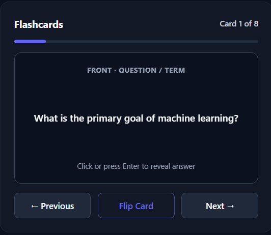
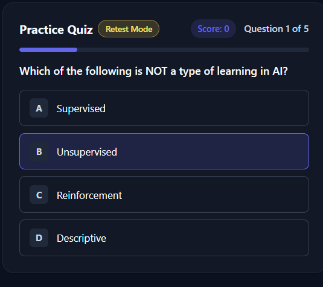
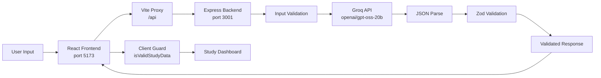

# StudyGen AI
### AI-Powered Interactive Study Assistant

StudyGen AI converts any topic or set of notes into structured study material — a summary, key concepts, interactive flashcards, and a multiple-choice quiz — powered by Groq AI.

> This is an interactive study application, not a chatbot. Each submission produces a fresh, self-contained study session.

---

## Screenshots

> Add screenshots to `docs/screenshots/` and update the paths below.

| Light Mode | Dark Mode |
|---|---|
|  |  |

| Flashcards | Quiz |
|---|---|
|  |  |

---

## Features

- AI-generated title, summary, and difficulty label (beginner / intermediate / advanced)
- Key concepts with definitions
- 5–10 interactive flip-able flashcards per generation
- 5–10 multiple-choice quiz questions, each with 4 options, immediate feedback, and an explanation
- Score tracking and retest for missed questions
- Light and dark themes with `localStorage` persistence and system preference detection
- Input validation on both frontend and backend
- Loading, error, and retry states
- Stale request prevention via `AbortController`
- Responsive layout

---

## Tech Stack

| Layer | Technologies |
|---|---|
| Frontend | React 18, Vite, plain CSS |
| Backend | Node.js, Express 5 |
| AI | Groq SDK — model `openai/gpt-oss-20b` |
| Validation | Zod (backend schema), native guard (frontend) |
| Dev tooling | concurrently, Node.js built-in test runner |

---

## Architecture



- The API key lives only on the server and is never exposed to the browser.
- The Vite proxy forwards `/api` requests to `localhost:3001` during development.
- AI responses pass through Zod validation on the server and a secondary guard on the client before any data is rendered.

---

## Project Structure

```
StudyGen AI/
├── client/
│   ├── index.html
│   ├── vite.config.js
│   └── src/
│       ├── App.jsx
│       ├── main.jsx
│       ├── components/
│       │   ├── InputForm.jsx
│       │   ├── StudyOverview.jsx
│       │   ├── ConceptsList.jsx
│       │   ├── Flashcards.jsx
│       │   ├── QuizSection.jsx
│       │   ├── StatusMessage.jsx
│       │   └── ErrorBoundary.jsx
│       ├── hooks/
│       │   ├── useStudyGen.js
│       │   └── useTheme.js
│       ├── styles/
│       └── tests/
│           └── studyValidation.test.js
├── server/
│   ├── index.js
│   ├── app.js
│   ├── .env.example
│   ├── routes/
│   │   └── generate.js
│   ├── lib/
│   │   ├── groqClient.js
│   │   ├── cardSchema.js
│   │   └── errors.js
│   └── tests/
│       ├── api.test.js
│       └── cardSchema.test.js
├── .gitignore
├── package.json
└── README.md
```

---

## Installation

**Prerequisites:** Node.js v18+, a free [Groq API key](https://console.groq.com)

```bash
# 1. Clone
git clone https://github.com/your-username/studygen-ai.git
cd studygen-ai

# 2. Install all dependencies (root + client + server)
npm install

# 3. Configure environment
cp server/.env.example server/.env
# Open server/.env and set GROQ_API_KEY=your_key_here

# 4. Start
npm start
```

| Service | URL |
|---|---|
| Frontend | http://localhost:5173 |
| Backend | http://localhost:3001 |

---

## Environment Variables

File: `server/.env` (gitignored — never commit this file)

```
GROQ_API_KEY=your_groq_api_key_here
```

Get a free key at [console.groq.com](https://console.groq.com). If the key is missing on startup, the backend exits with a clear setup message.

---

## How to Use

1. Enter a topic or paste notes (up to 5000 characters) and click **Generate**
2. Read the AI-generated summary and key concepts
3. Flip through flashcards using the Previous / Next controls
4. Answer each quiz question — feedback and an explanation appear immediately
5. See your final score; use **Retest Missed Questions** to drill weak spots
6. Toggle light/dark theme from the header button — preference is saved automatically

---

## Testing

```bash
npm test                    # all tests
npm test --prefix server    # server only
npm test --prefix client    # client only
```

```
Server: 22 passed, 0 failed
Client:  5 passed, 0 failed
Total:  27 passed, 0 failed
```

Tests cover input validation, AI response validation (mocked Groq), upstream failures, Zod schema boundaries, and client-side data guards. Framework: Node.js built-in `node:test`.

---

## Security

- `GROQ_API_KEY` is server-side only — never sent to the browser
- `server/.env` is gitignored; only `server/.env.example` (placeholder) is tracked
- AI responses are Zod-validated before returning data to the client
- Unexpected errors return a generic `500` message — no stack traces exposed

---

## Known Limitations

- AI-generated content may contain inaccuracies; verify against authoritative sources
- Requires an active Groq API key and internet connection
- No persistent storage — refreshing the page clears the session
- One topic per session; previous results are replaced on each generation

---

## AI Usage Disclosure

This project was built with assistance from **Google Antigravity** (an AI coding assistant). AI was used to help scaffold components, write tests, implement error handling patterns, and develop the theme system. All code was reviewed, tested, and directed by the developer.

---

## Development Time

Development time: To be updated by the author.

---

## Future Improvements

- Persist study history across sessions
- Export flashcards and quiz as PDF or text
- User-configurable flashcard and quiz counts
- Shareable topic links
