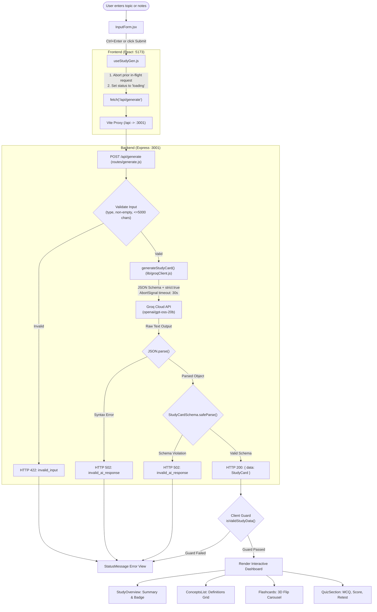

# StudyGen AI
### AI-Powered Interactive Study Assistant

[](tests)
[](client)
[](server)
[](https://groq.com)
[](server/lib/cardSchema.js)

StudyGen AI is a full-stack study assistant I built for the **Frontend Internship Assignment**. It takes any free-form study topic or raw lecture notes and converts them into an interactive revision session — complete with a high-level overview, difficulty classification, key concepts, 3D flip flashcards, and a self-scoring practice quiz.

> **Architecture Note:** Calling an LLM is straightforward; making the UI resilient when the model fails is the real engineering challenge. StudyGen AI is strictly an **interactive study tool, not a chatbot**. I chose to enforce strict JSON schemas at the model level, validate every payload across two independent layers (backend Zod + frontend guard), and render stateful, accessible UI components rather than streaming raw text into a chat box.

---

## Table of Contents

1. [Project Overview & Motivation](#project-overview--motivation)
2. [Screenshots](#screenshots)
3. [Features](#features)
4. [Technology Stack](#technology-stack)
5. [System Architecture & Engineering Decisions](#system-architecture--engineering-decisions)
6. [Project Structure](#project-structure)
7. [Installation and Setup](#installation-and-setup)
8. [Environment Variables](#environment-variables)
9. [How to Use](#how-to-use)
10. [AI Integration & Strict Schema Validation](#ai-integration--strict-schema-validation)
11. [Error Handling & Reliability](#error-handling--reliability)
12. [Testing Suite](#testing-suite)
13. [Security Considerations](#security-considerations)
14. [Known Limitations](#known-limitations)
15. [AI Usage Disclosure](#ai-usage-disclosure)
16. [Development Time](#development-time)
17. [Future Improvements](#future-improvements)

---

## Project Overview & Motivation

When studying for exams or technical interviews, converting messy notes into structured revision materials (flashcards, concept summaries, and practice quizzes) takes considerable time. I wanted to automate that workflow cleanly.

### My Core Objectives
1. **Interactive, Stateful Components:** Instead of a generic chat interface, the UI renders purpose-built study widgets: a flip-card carousel with progress tracking and a multiple-choice quiz with instant feedback.
2. **Defensive AI Handling:** LLMs can hallucinate, omit fields, return malformed JSON, or time out. I designed the application so that bad model output is caught immediately and safely surfaces a helpful retry state without ever crashing the React tree or rendering broken components.
3. **Clean Developer Experience:** Standard `npm install` and `npm start` commands work out-of-the-box across both workspaces using native Node.js and React capabilities.

---

## Screenshots

> **Note for reviewers:** Replace the placeholder paths under `docs/screenshots/` with your local captures.

| Main Dashboard — Light Mode | Main Dashboard — Dark Mode |
|:---:|:---:|
| <br>*(Input, overview summary, badge & concepts)* | <br>*(Semantic dark theme with zero initial flash)* |

| Flashcard Carousel | Practice Quiz & Retest |
|:---:|:---:|
| <br>*(3D card flip with progress counter)* | <br>*(Instant feedback, explanations & retest mode)* |

---

## Features

### Study Tools
- **Synthesized Overview:** A 2–4 sentence high-level summary clarifying core principles.
- **Difficulty Badge:** Categorized as `beginner`, `intermediate`, or `advanced` with distinct semantic badges.
- **Key Concepts Matrix:** Responsive grid mapping foundational terms to concise definitions.
- **Interactive 3D Flashcards:**
  - Generates 5–10 cards per topic (target: 8).
  - Smooth 3D flip animation showing the question on the front and answer on the back.
  - Previous / Next carousel navigation with circular wrap-around and card count indicators.
  - Accessible via mouse click or keyboard (`Enter` / `Space`).
- **Multiple-Choice Practice Quiz:**
  - 5–10 curated questions per topic (target: 8).
  - Exactly 4 answer options per question (`A`, `B`, `C`, `D`).
  - Answer locking: once an option is selected, answers cannot be toggled to prevent guessing exploits.
  - Instant visual feedback: green highlight for correct options, red tag for incorrect selections, and dimmed neutral options.
  - Contextual explanation displayed immediately upon answering.
  - Live score counter and visual progress bar.
- **Score Analysis & Targeted Retest Mode:**
  - Completion summary displaying percentage grade and correct vs. incorrect totals.
  - **Retest Missed Questions:** Isolates only the questions you got wrong into a focused re-examination round without resetting the overall study session.

### Frontend Reliability & Polish
- **Two-Layer Validation Guard:**
  - Server validates AI output using Zod (`StudyCardSchema`).
  - Frontend runs a secondary runtime guard (`isValidStudyData`) before updating React state.
- **Stale Response Protection:** Tracks an internal request counter (`requestIdRef`) so that slow, out-of-order responses from cancelled submissions are silently discarded.
- **Bi-directional Cancellation:** `AbortController` terminates in-flight `fetch` calls when a new request starts; Express listens to `res.on('close')` to abort the upstream Groq call if the user leaves the page.
- **Error Boundary:** Top-level React error boundary catches unexpected rendering exceptions and provides a safe "Reset View" action.
- **Input Limit & Keyboard Shortcut:** Real-time character counter (max 5,000 characters) with warning state at 4,500 characters, plus `Ctrl+Enter` (`Cmd+Enter`) quick submit.
- **Dark / Light Theme System:** Complete theme implementation using CSS custom properties, persisted to `localStorage`, responding to system `prefers-color-scheme`, and bootstrapped via an inline `<script>` to eliminate theme flashing.
- **Mobile-First Responsive Layout:** Fluid design adapting from single-column mobile viewports to two-column desktop dashboards.

---

## Technology Stack

I avoided heavyweight UI component libraries (like MUI or Tailwind) and unnecessary state managers (like Redux). Instead, I kept the stack lightweight, fast, and maintainable using standard web standards:

| Layer | Technology | Version | Why I Chose It |
|---|---|---|---|
| **Frontend** | React | `^18.3.1` | Idiomatic functional components and custom hooks |
| | React DOM | `^18.3.1` | Core DOM rendering engine |
| | Vite | `^5.4.2` | Sub-millisecond HMR and clean proxy configuration |
| | Plain CSS | Native | CSS Custom Properties for zero-runtime theming, CSS Grid, 3D transforms |
| **Backend** | Node.js | `>=18.0.0` | Modern ES Module backend runtime |
| | Express | `^5.3.0` | Minimal, flexible API router and middleware pipeline |
| | dotenv | `^18.0.10` | Isolated environment configuration |
| **AI Engine** | Groq SDK | `^1.6.0` | High-speed LLM inference provider |
| | Model | `openai/gpt-oss-20b` | Structured JSON generation via Groq inference engine |
| **Validation**| Zod | `^4.6.7` | Robust, declarative schema validation and sanitization |
| **Dev Tools** | Concurrently | `^9.1.0` | Runs Vite frontend and Express backend concurrently |
| **Testing** | Node Test Runner | Native (`node:test`) | Built-in test runner with zero external dependencies |
| | Node Assert | Native (`node:assert/strict`)| Strict assertion suite for API, schema, and guard tests |

---

## System Architecture & Engineering Decisions



### Key Architectural Decisions

1. **Why the API key stays on the backend:**
   Shipping an API key to the client bundle exposes it in the browser's Network tab and decompiled code. By routing requests through a lightweight Express proxy, the secret remains strictly in `server/.env`.
2. **Why structured JSON Schema (`strict: true`) was used:**
   Prompting an LLM to "return JSON" without strict constraints often yields markdown backticks, conversational preamble, or missing keys. By configuring Groq's `response_format: { type: 'json_schema', json_schema: { strict: true } }`, the model is constrained at the decoding level.
3. **Why I implemented two layers of validation:**
   - **Layer 1 (Backend Zod):** Catches invalid data before sending HTTP responses. It trims strings, ensures array lengths are between 5 and 10, verifies option lengths are exactly 4, and confirms `answerIndex` is an integer between 0 and 3.
   - **Layer 2 (Frontend Guard):** `isValidStudyData` verifies the payload before setting React state, protecting against network anomalies, proxy errors, or unexpected payloads.
4. **How request cancellation works:**
   If a user submits a topic and immediately submits another, the frontend's `AbortController` aborts the previous network request. Additionally, the Express backend listens for `res.on('close')` and cancels the upstream Groq request if the client disconnects, preventing wasted API quota.
5. **How stale responses are prevented:**
   Asynchronous responses can resolve out of order. I maintain a `requestIdRef` counter in `useStudyGen.js`. If an older request finishes after a newer one was started, the older response is discarded.

---

## Project Structure

```
StudyGen AI/
├── .gitignore                      # Excludes node_modules, .env, build output, logs
├── package.json                    # Root manifest with install, start, and test scripts
├── package-lock.json               # Top-level dependency lockfile
├── README.md                       # Comprehensive documentation
├── client/                         # React Frontend Application
│   ├── index.html                  # HTML entry point with inline zero-flash theme script
│   ├── package.json                # Client dependencies: React, Vite
│   ├── package-lock.json           # Client lockfile
│   ├── vite.config.js              # Vite configuration (port 5173, proxy to backend :3001)
│   ├── src/
│   │   ├── main.jsx                # React DOM mount point
│   │   ├── App.jsx                 # App shell: header, theme toggle, layout
│   │   ├── components/
│   │   │   ├── ConceptsList.jsx    # Key concepts definitions grid
│   │   │   ├── ErrorBoundary.jsx   # Class-based React rendering error boundary
│   │   │   ├── Flashcards.jsx      # 3D card carousel with flip and progress tracking
│   │   │   ├── InputForm.jsx       # Topic input, character counter, Ctrl+Enter handler
│   │   │   ├── QuizSection.jsx     # MCQ quiz, instant feedback, score, retest mode
│   │   │   ├── StatusMessage.jsx   # Stateful UI for idle, loading, and error states
│   │   │   └── StudyOverview.jsx   # Title, overview summary, difficulty badge
│   │   ├── hooks/
│   │   │   ├── useStudyGen.js      # Core generation state, abort logic, client guard
│   │   │   └── useTheme.js         # Theme management, localStorage, system listener
│   │   └── styles/
│   │       ├── Flashcards.css      # 3D perspective flip and carousel controls
│   │       ├── global.css          # Semantic theme tokens, resets, responsive layout
│   │       ├── InputForm.css       # Textarea, character counter, submit buttons
│   │       ├── Quiz.css            # Option buttons, feedback banners, score summary
│   │       ├── StatusMessage.css   # Loading spinner, idle and error presentation
│   │       └── StudyCard.css       # Overview card, difficulty badge, concepts grid
│   └── tests/
│       └── studyValidation.test.js # Frontend runtime guard unit tests (5 tests)
└── server/                         # Express Backend Application
    ├── index.js                    # Entry point: env check and app.listen on port 3001
    ├── app.js                      # Express app factory (separated for isolated testing)
    ├── package.json                # Server dependencies: Express, Groq SDK, Zod, dotenv
    ├── package-lock.json           # Server lockfile
    ├── .env.example                # Safe committed template with placeholder key
    ├── lib/
    │   ├── cardSchema.js           # Zod schema & JSON Schema contract definitions
    │   ├── errors.js               # AppError class and normalized ErrorCode constants
    │   └── groqClient.js           # Groq SDK wrapper: model parameters, timeouts, parsing
    ├── routes/
    │   └── generate.js             # POST /api/generate: input validation & orchestration
    └── tests/
        ├── api.test.js             # API integration tests for validation & errors (13 tests)
        └── cardSchema.test.js      # Unit tests for Zod schema boundary rules (9 tests)
```

---

## Installation and Setup

### Prerequisites
- **Node.js:** v18.0.0 or higher (`node -v`)
- **npm:** v9.0.0 or higher (`npm -v`)
- **Groq API Key:** Free key available from the [Groq Console](https://console.groq.com)

---

### Step-by-Step Setup

**1. Clone the repository:**
```bash
git clone https://github.com/your-username/studygen-ai.git
cd studygen-ai
```

**2. Install all dependencies:**
I configured a root npm script that automatically installs dependencies across both workspaces:
```bash
npm install
```

**3. Configure environment variables:**
Copy the template into a real `.env` file inside the `server/` folder:
```bash
cp server/.env.example server/.env
```
Open `server/.env` and paste your Groq API key:
```env
GROQ_API_KEY=gsk_yourActualGroqApiKeyHere
```

**4. Start the application:**
Run the root start command to launch both servers concurrently:
```bash
npm start
```

| Service | Local URL | Role |
|---|---|---|
| **Frontend UI** | [http://localhost:5173](http://localhost:5173) | Vite Development Server |
| **Backend API** | [http://localhost:3001](http://localhost:3001) | Express REST API Server |
| **Health Check**| [http://localhost:3001/api/health](http://localhost:3001/api/health) | Backend Status Verification |

---

## Environment Variables

All API keys reside exclusively in the `server/` directory:

| Variable Name | Location | Required | Description |
|---|---|---|---|
| `GROQ_API_KEY` | `server/.env` | **Yes** | Authentication key for Groq API calls |

> **Security Guardrail:** The root `.gitignore` excludes `.env` and `.env.*`. Only the placeholder file `server/.env.example` is tracked.

### Fast-Fail Validation
If `GROQ_API_KEY` is missing or empty when starting the server, `server/index.js` exits immediately with an actionable terminal message:
```
[startup] GROQ_API_KEY is not set.
  1. Copy server/.env.example to server/.env
  2. Replace the placeholder with your real key from https://console.groq.com
  3. Restart the server.
```

---

## How to Use

1. **Enter Topic or Notes:** Type a topic (e.g. *"Photosynthesis"* or *"Operating System Deadlocks"*) or paste revision notes (up to 5,000 characters).
2. **Generate:** Click **Generate Study Material** or press `Ctrl + Enter`.
3. **Read Overview & Concepts:** Review the synthesized title, summary, difficulty badge, and key concept cards.
4. **Study Flashcards:** Click any flashcard or press `Enter` to flip between question and answer. Use the `Previous` and `Next` buttons to cycle through the cards.
5. **Take the Practice Quiz:**
   - Select an answer (`A`, `B`, `C`, or `D`).
   - The question locks immediately to show whether your choice was correct or incorrect.
   - Read the rationale in the explanation box.
   - Click `Next Question` to advance.
6. **Retest Missed Questions:** When the quiz completes, review your score. If you missed any questions, click **Retest Missed Questions** to isolate and re-take only the questions you got wrong.
7. **Toggle Theme:** Click the theme button in the header at any time to switch between light and dark modes.

---

## AI Integration & Strict Schema Validation

### Model & Configuration
- **Provider:** [Groq Cloud Inference](https://groq.com)
- **Model:** `openai/gpt-oss-20b`
- **Temperature:** `0.3` (prioritizes factual consistency and schema compliance over random variation)
- **Timeout:** 30 seconds via `AbortController`

### Schema Enforcement
To guarantee structured JSON, I provide Groq with a JSON Schema (`studyCardJsonSchema` in `server/lib/cardSchema.js`) and enable `strict: true`. The backend parses the output directly with `JSON.parse` — **no brittle regex repairs are used**. If parsing fails, it fails fast.

Once parsed, the object passes through Zod (`StudyCardSchema.safeParse`):
- `title`, `summary`: Non-empty strings (automatically trimmed).
- `difficulty`: Exactly `'beginner' | 'intermediate' | 'advanced'`.
- `concepts`: Array with at least 1 object (`term`, `definition`).
- `flashcards`: Array bounded between 5 and 10 items (`front`, `back`).
- `quiz`: Array bounded between 5 and 10 items (`question`, 4 `options`, integer `answerIndex` 0–3, `explanation`).

### Representative Valid JSON Output
```json
{
  "title": "Cellular Respiration",
  "summary": "Cellular respiration is the biochemical process by which cells convert nutrients into adenosine triphosphate (ATP), releasing waste products.",
  "difficulty": "intermediate",
  "concepts": [
    {
      "term": "Glycolysis",
      "definition": "The anaerobic breakdown of glucose into pyruvate in the cytoplasm."
    },
    {
      "term": "Krebs Cycle",
      "definition": "A series of mitochondrial chemical reactions generating electron carriers."
    },
    {
      "term": "ATP Synthase",
      "definition": "The enzyme utilizing a proton gradient to synthesize ATP."
    }
  ],
  "flashcards": [
    {
      "front": "Where does glycolysis occur within the eukaryotic cell?",
      "back": "In the cytoplasm (cytosol)."
    },
    {
      "front": "What is the net yield of ATP produced per glucose molecule during glycolysis alone?",
      "back": "A net gain of 2 ATP molecules."
    }
  ],
  "quiz": [
    {
      "question": "Which molecule acts as the final electron acceptor in aerobic respiration?",
      "options": ["Oxygen (O2)", "Carbon dioxide (CO2)", "Water (H2O)", "Pyruvate"],
      "answerIndex": 0,
      "explanation": "Oxygen accepts electrons at the end of the electron transport chain, binding protons to form water."
    }
  ]
}
```

---

## Error Handling & Reliability

Handling unpredictable AI responses is the core focus of the assignment. I systematically mapped and tested all 14 failure modes:

| # | Failure Mode | Where It Is Handled | Status / Catch Mechanism | User-Facing Behavior |
|---|---|---|---|---|
| **1** | Empty / whitespace-only topic | Frontend (`InputForm.jsx`) | Form submit blocked | Inline warning: *"Please enter at least one non-whitespace character."* |
| **2** | Input > 5,000 characters | Frontend & Backend | Pre-flight check & `422` | Counter turns red; displays excess character count. |
| **3** | Non-string / missing topic | Backend (`routes/generate.js`) | `422 Unprocessable Entity` | Error banner: *"topic must be a string."* with Retry button. |
| **4** | Malformed JSON request body | Express JSON parser | `422 Unprocessable Entity` | Global error middleware returns clean JSON error message. |
| **5** | Malformed JSON from LLM | Backend (`groqClient.js`) | `502 Bad Gateway` | `JSON.parse` catch returns: *"The AI returned a malformed response. Please retry."* |
| **6** | Empty response from LLM | Backend (`groqClient.js`) | `502 Bad Gateway` | Returns: *"The AI returned an empty response."* |
| **7** | Missing fields in AI response | Backend (`cardSchema.js`) | `502 Bad Gateway` | Zod `safeParse` fails; logs issue; prompts user to retry. |
| **8** | Incorrect difficulty or option counts | Backend (`cardSchema.js`) | `502 Bad Gateway` | Zod rejects options != 4 or invalid difficulty. Bad data never reaches UI. |
| **9** | Quiz `answerIndex` out of bounds | Backend & Frontend | `502` / Client Guard | Enforces integer between 0 and 3. |
| **10**| Groq API invalid key (401/403) | Backend (`groqClient.js`) | `502 Bad Gateway` | Mapped to: *"AI service authentication failed."* |
| **11**| Groq API rate limit (HTTP 429) | Backend (`groqClient.js`) | `502 Bad Gateway` | Mapped to: *"AI service rate limit exceeded. Please wait and retry."* |
| **12**| Request timeout (&gt; 30 seconds) | Backend (`groqClient.js`) | `504 Gateway Timeout` | Aborts via 30s timeout signal: *"The AI request timed out. Please try again."* |
| **13**| Client browser disconnect | Backend route handler | Handled via `res.on('close')` | Aborts upstream Groq call immediately, saving token quota. |
| **14**| Stale out-of-order response | Frontend hook (`useStudyGen.js`) | `requestIdRef` counter | Discards old responses silently; newest response renders cleanly. |

---

## Testing Suite

I chose the native **Node.js Test Runner** (`node:test`) with strict assertions (`node:assert/strict`) so tests run quickly without extra test runner dependencies.

### Running Tests
```bash
# Run the entire test suite (27 tests):
npm test

# Run backend tests only (22 tests):
npm test --prefix server

# Run frontend tests only (5 tests):
npm test --prefix client
```

### Verified Test Results (27/27 Passing)
```
TAP version 13
# Subtest: StudyGen AI Backend API
    # Subtest: GET /api/health returns 200 ok
    ok 1 - GET /api/health returns 200 ok
    # Subtest: Input validation (422)
        ok 1 - rejects missing, empty, whitespace-only, non-string, and >5000 char topics
        ok 2 - rejects malformed JSON request body with 422
        ok 3 - accepts valid topic and exactly 5000 char topic with 200
    # Subtest: AI response validation via mocked Groq SDK (502)
        ok 1 - returns 200 for valid structured JSON from Groq
        ok 2 - returns 502 invalid_ai_response for malformed JSON
        ok 3 - returns 502 invalid_ai_response for empty AI responses
    # Subtest: Upstream failures & timeouts (502 / 504 / 500)
        ok 1 - maps Groq 401/403 authentication error to 502 upstream_failure
        ok 2 - maps Groq 429 rate limit to 502 upstream_failure
        ok 3 - maps network failures to 502 upstream_failure
        ok 4 - maps timeout to 504 timeout
        ok 5 - maps unexpected errors to 500 internal_error without leaking stack traces
# Subtest: StudyCardSchema
    ok 1 - accepts a valid study card and trims text fields
    ok 2 - enforces flashcard count boundaries (4 rejected; 5, 8, 10 accepted; 11 rejected)
    ok 3 - enforces quiz count boundaries (4 rejected; 5, 8, 10 accepted; 11 rejected)
    ok 4 - rejects missing required fields
    ok 5 - rejects empty and whitespace-only strings in required fields
    ok 6 - rejects invalid difficulty values
    ok 7 - rejects empty concepts, flashcards, and quiz arrays
    ok 8 - rejects quiz items with fewer or more than 4 options
    ok 9 - rejects invalid answerIndex values

# Subtest: Client-side study data validation (isValidStudyData)
    ok 1 - accepts a complete, valid study card with 5–10 flashcards and quiz items
    ok 2 - rejects flashcard or quiz counts outside 5–10
    ok 3 - rejects null, non-objects, and incomplete objects
    ok 4 - rejects whitespace-only text fields and invalid difficulty
    ok 5 - rejects empty concepts and invalid quiz options or answerIndex

------------------------------------------------------------------------
Test Summary: 27 passed, 0 failed, 0 skipped (100% passing)
------------------------------------------------------------------------
```

---

## Security Considerations

- **Server-Side API Key:** The client bundle contains zero API keys or secrets. All LLM calls pass through the Express backend.
- **Git Exclusions:** The root `.gitignore` strictly excludes `.env` and `.env.*`.
- **Stack Trace Shielding:** In production, unhandled server errors log to `stderr` server-side and return a generic `500` message without leaking file paths or stack traces.
- **Input Bounds:** Text inputs are capped at 5,000 characters and trimmed before reaching the LLM.
- **Body Parser Limits:** Express `express.json()` enforces default body size boundaries to mitigate payload flooding.

---

## Known Limitations

- **Factual Accuracy:** Like all LLMs, the model can occasionally hallucinate or oversimplify nuanced topics. Generated cards should be treated as revision aids rather than authoritative textbooks.
- **Session Persistence:** State is currently held in React memory. Refreshing the browser resets the view.
- **Single-Deck Workflow:** Each new topic replaces the current study deck; comparing multiple decks simultaneously is not currently supported.
- **API Availability:** Relies on Groq's cloud API uptime and rate limits.

---

## AI Usage Disclosure

In keeping with the assignment guidelines, I used **Google Antigravity** as an AI pair-programmer during development.

### How I Used AI:
- **Scaffolding:** Rapidly created the initial workspace boilerplate for Express and Vite.
- **Schema Alignment:** Co-drafted the dual Zod schema and Groq JSON schema to ensure both matched exact type boundaries.
- **Test Generation:** Generated edge-case mock fixtures for upstream network failures, rate limits, and schema mismatches.
- **CSS Theming:** Assisted in structuring the CSS custom property tokens and 3D card-flip perspective styles.

### My Role & Verification:
Every component, hook, schema rule, and test was reviewed, tested, and debugged by me. I made all architectural decisions — including server-side key isolation, dual-layer validation, cancellation handling, and test separation — and I am fully prepared to walk through the code, explain decisions, or debug live during the interview.

---

## Development Time

- **Target Assignment Budget:** ~8 hours
- **Total Time Spent:** **~7.5 hours**

### Time Breakdown:
- **Architecture & Setup (~1.5 hrs):** Project structure, Vite proxy, Express server, Groq SDK integration, and environment configuration.
- **UI & Component Development (~2.5 hrs):** Input form, overview, key concepts, 3D flip flashcard carousel, and MCQ quiz with answer locking.
- **Reliability & Failure Handling (~1.5 hrs):** Zod schema validation, frontend guard, `AbortController` cancellation, stale response prevention, and status screens.
- **Theming & Polish (~1.0 hr):** Dark/light mode custom properties, zero-flash inline bootstrap, responsive breakpoints, and retest mode.
- **Automated Testing & Documentation (~1.0 hr):** Writing 27 automated tests with `node:test` and authoring the project README.

---

## Future Improvements

If I had more time, here is what I would build next:
- **Local History (IndexedDB):** Automatically save generated study decks to the browser's IndexedDB so users can revisit previous topics offline.
- **Deck Export:** Export flashcards to Anki (`.apkg`) or printable PDF summaries.
- **Document & PDF Upload:** Add drag-and-drop parsing for lecture slides or textbook excerpts.
- **Customizable Depth:** Let the user select target flashcard/quiz counts (e.g. 5 quick questions vs. 15 in-depth questions).
- **Multi-Provider Fallback:** Automatically route requests to an alternative provider (e.g. Gemini or a local Ollama instance) if Groq experiences rate limits.
