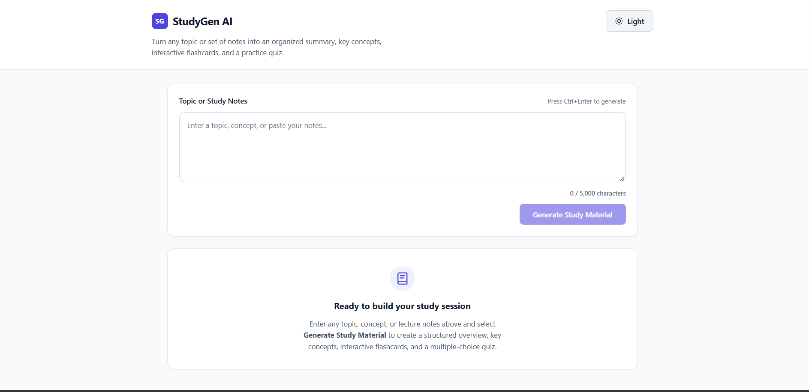
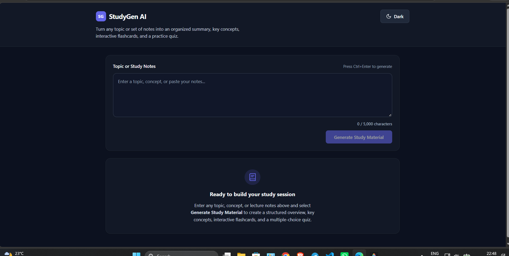
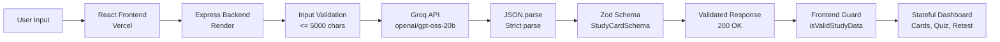

# StudyGen AI — Interactive Study Assistant

[](https://study-gen-ai-sage.vercel.app)
[](https://study-gen-ai-backend.onrender.com)
[](tests)
[](#tech-stack)

StudyGen AI is an interactive study tool built for the **Frontend Internship Assignment** (Study Assistant track). It takes any free-form topic or lecture notes, sends it to an LLM, and turns the structured result into flip-able flashcards, key concepts, and an interactive quiz with retesting.

> **Firm Requirement:** **This is an interactive application, not a chatbot.** The model returns strict JSON that is validated on both backend and frontend, and rendered as interactive, stateful UI components.

---

## Live Deployments

- **Frontend (Vercel):** [https://study-gen-ai-sage.vercel.app](https://study-gen-ai-sage.vercel.app)
- **Backend (Render):** [https://study-gen-ai-backend.onrender.com](https://study-gen-ai-backend.onrender.com) *(Health check: `/api/health`)*
- **Demo Video:** `[INSERT SHORT SCREEN RECORDING LINK HERE]`

---

## Screenshots

| Dashboard (Light Mode) | Dashboard (Dark Mode) |
|:---:|:---:|
|  |  |

| 3D Flip Flashcards | Quiz & Retest Mode |
|:---:|:---:|
|  |  |

*(Place local screenshots in `docs/screenshots/`)*

---

## Features

- **Free-Form Text Input:** Accepts topics or raw notes up to 5,000 characters with live character counter, limit warnings, and `Ctrl+Enter` shortcut.
- **Structured Overview & Difficulty:** 2–4 sentence summary and difficulty classification (`beginner`, `intermediate`, `advanced`).
- **Key Concepts:** Structured matrix of terms and plain-language definitions.
- **Interactive Flashcards:** 5–10 cards per generation (target: 8) with smooth 3D flip animation, carousel navigation, and keyboard support (`Enter` / `Space`).
- **Practice Quiz:** 5–10 questions with exactly 4 options, single-choice answer locking, instant visual feedback, rationale explanations, and live score counter.
- **Retest Missed Questions:** Isolates incorrectly answered questions into a dedicated retest round without wiping the study session.
- **Dark / Light Theme:** Custom CSS properties, theme toggle in header, persistent preference in `localStorage`, system preference fallback, and zero theme flash on page load.
- **Mobile Responsive:** Adapts cleanly from single-column mobile viewports to multi-column desktop layouts.
- **Loading, Empty & Error States:** Clear visual feedback for idle state, animated loading spinner, and actionable error cards with one-click retry.

---

## Handling Bad AI Output & Failures

The assignment places primary evaluation weight (20%) on handling unpredictable AI outputs. Here is how StudyGen AI handles all failure scenarios:

| Failure Scenario | Detection Point | Handling & Recovery | User-Facing Result |
|---|---|---|---|
| **Empty / Whitespace Input** | Frontend (`InputForm.jsx`) | Form submit blocked | Inline message: *"Please enter at least one non-whitespace character."* |
| **Input > 5,000 Characters** | Frontend & Backend | Capped at textarea; rejected with `422` on API | Character counter turns red; submit disabled. |
| **Malformed JSON from LLM** | Backend (`groqClient.js`) | `JSON.parse` fails fast (no brittle regex repair) | HTTP `502 invalid_ai_response`; clean error card with Retry. |
| **Empty LLM Response** | Backend (`groqClient.js`) | Checked before parsing | HTTP `502`; error card with Retry. |
| **Wrong Shape / Missing Fields** | Backend (`cardSchema.js`) | Zod `StudyCardSchema.safeParse` rejects invalid structure | HTTP `502`; bad data never reaches the client. |
| **Wrong Options / Bad Answer Index** | Backend (`cardSchema.js`) | Zod enforces exactly 4 options and `0 <= answerIndex <= 3` | HTTP `502`; rejected before response is sent. |
| **Slow Response / Hang (>30s)** | Backend (`groqClient.js`) | 30s `AbortController` timeout | HTTP `504 timeout`: *"The AI request timed out. Please try again."* |
| **Client Disconnect** | Backend (`routes/generate.js`) | Express listens to `res.on('close')` | Cancels upstream Groq call immediately; saves token quota. |
| **Stale / Out-of-Order Responses** | Frontend (`useStudyGen.js`) | Incremental `requestIdRef` counter | Older responses from cancelled requests are silently discarded. |
| **Network / Groq API Outage** | Backend (`groqClient.js`) | Maps SDK errors (401, 429, network failure) | HTTP `502 upstream_failure`; friendly error message shown. |
| **Frontend Guard** | Frontend (`useStudyGen.js`) | `isValidStudyData` verifies payload before `setState` | Prevents rendering crashes if unexpected data reaches client. |
| **React Render Error** | Frontend (`ErrorBoundary.jsx`) | Top-level class component Error Boundary | Shows friendly error screen with a "Reset View" button. |

---

## Tech Stack & Architecture



- **Frontend:** React 18, Vite 5, plain CSS with custom property tokens (no UI libraries or heavyweight state managers).
- **Backend:** Node.js, Express 5, CORS configured for Vercel origins, zero exposed secrets.
- **AI Integration:** Groq SDK (`openai/gpt-oss-20b`), temperature `0.3`, strict `json_schema` response format.
- **Validation:** Zod v4 (backend schema) + native defensive guard (frontend).
- **Testing:** Node.js built-in test runner (`node:test`) and strict assertions (`node:assert/strict`).

---

## Local Setup & Running Instructions

### Prerequisites
- Node.js v18+ (`node -v`)
- A free Groq API key from [console.groq.com](https://console.groq.com)

### Steps

```bash
# 1. Clone the repository
git clone https://github.com/your-username/studygen-ai.git
cd studygen-ai

# 2. Install all dependencies (root, client, server)
npm install

# 3. Configure environment variable
cp server/.env.example server/.env
# Add your GROQ_API_KEY in server/.env

# 4. Start both frontend and backend concurrently
npm start
```

- **Frontend:** `http://localhost:5173`
- **Backend:** `http://localhost:3001`

---

## Environment Variables

| Variable | Location | Required | Description |
|---|---|---|---|
| `GROQ_API_KEY` | `server/.env` (local) / Render dashboard | **Yes** | Authentication key for Groq API |
| `VITE_API_URL` | Vercel Project Settings (production only) | No (prod only) | Backend base URL (e.g. `https://study-gen-ai-backend.onrender.com`) |

> **Security:** The Groq API key is kept exclusively on the server and is never sent to the browser. `server/.env` is gitignored.

---

## How to Use

1. Enter a topic or paste revision notes (up to 5,000 characters).
2. Click **Generate Study Material** or press `Ctrl + Enter`.
3. Read the summary and key concepts.
4. Flip through flashcards using click/Enter, and navigate with Previous / Next.
5. Answer quiz questions — view instant feedback and explanation.
6. Check your score on the summary card. If you missed any, click **Retest Missed Questions** to practice only what you got wrong.
7. Toggle light/dark mode using the button in the header.

---

## Testing

```bash
# Run all tests (27 tests total)
npm test

# Run backend tests only (22 tests)
npm test --prefix server

# Run frontend tests only (5 tests)
npm test --prefix client
```

### Verified Test Results
```
Server tests (api.test.js & cardSchema.test.js): 22 passed, 0 failed
Client tests (studyValidation.test.js):          5 passed, 0 failed
Total:                                         27 passed, 0 failed (100%)
```

Tests cover input validation (missing, empty, >5000 chars, malformed JSON), mocked Groq failure modes (malformed JSON, empty response, missing fields, option counts != 4, invalid answerIndex), timeouts, 401/429 upstream errors, and client runtime guard bounds.

---

## AI Usage Disclosure

In compliance with the assignment guidelines, I used **Google Antigravity** as an AI pair-programmer during development:
- Scaffolded initial workspace structure (Vite + Express).
- Co-drafted Zod schema and Groq `json_schema` definitions to ensure type alignment.
- Generated mock edge-case fixtures for automated tests (network drops, rate limits, timeouts).
- Assisted with CSS custom property tokens and 3D card-flip perspective styles.

Every line of code, component architecture, and failure-handling mechanism was reviewed, tested, debugged, and understood by me.

---

## Known Limitations

- **Content Accuracy:** AI output can occasionally oversimplify or hallucinate; cards are intended as revision aids, not authoritative textbooks.
- **Session Persistence:** State is stored in React memory; refreshing the page resets the current session (no database).
- **Single Deck at a Time:** Each generation replaces the current study session.
- **API Quotas:** Generation depends on Groq API uptime and free-tier rate limits.

---

## Time Spent

- **Total Time:** **~7.5 hours** (within the ~8-hour assignment budget)
- **Breakdown:**
  - Setup & Backend API with Groq: ~1.5 hrs
  - Frontend UI, Flashcards & Quiz with Retest: ~2.5 hrs
  - Error Handling, Validation & AbortController: ~1.5 hrs
  - Dark Mode, Responsive Design & Polish: ~1.0 hr
  - Automated Tests & Documentation: ~1.0 hr
